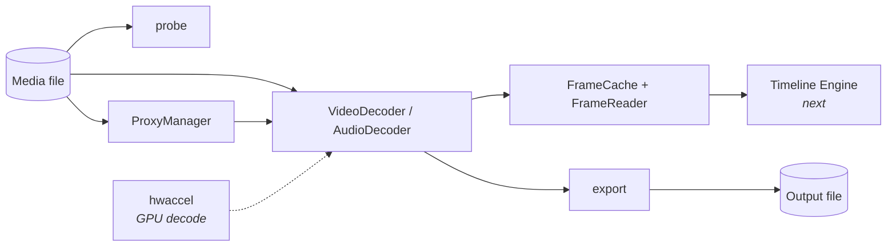
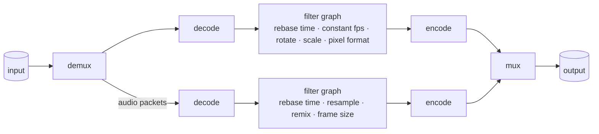

<div align="center">

# OriginFX Media Engine

**Open any video. Know what's in it. Jump to any frame. Export it anywhere.**

The first of OriginFX's ten engines: a plain Rust library (and a small command-line tool)
that handles everything that touches a media file.

`Rust` · `FFmpeg 6.1` · `no UI` · `no telemetry` · `fully offline`

</div>

---

## Contents

1. [What it is](#1-what-it-is)
2. [Quick start](#2-quick-start)
3. [The `originfx` command line](#3-the-originfx-command-line)
4. [Using it as a library](#4-using-it-as-a-library)
5. [Export presets](#5-export-presets)
6. [How it works](#6-how-it-works)
7. [Performance](#7-performance)
8. [Testing](#8-testing)
9. [Status and limits](#9-status-and-limits)
10. [Troubleshooting](#10-troubleshooting)
11. [Extending it](#11-extending-it)

---

## 1. What it is

A video editor needs one component that knows how to deal with files: open anything,
report what's inside, hand back the exact frame at 00:12.480, play audio, and write a
finished video in the format you pick. Everything else in OriginFX (timeline, effects,
rendering) builds on top of that. This is it.



**Design rules**

- **It is a library, not an app.** No windows, no buttons. Other engines call it; the CLI is only a thin front-end for trying it out.
- **No FFmpeg types in the public API.** The rest of OriginFX never imports FFmpeg, so the backend can change without breaking anything above it.
- **Correct before fast.** Seeking is frame-accurate, rotation is applied, output is constant frame rate. GPU decoding is optional and returns exactly the same frames as software (see [GPU decoding](#gpu-decoding)).
- **Private.** Nothing leaves your machine.

---

## 2. Quick start

You need Ubuntu 24.04 (or anything with FFmpeg 6.1 development libraries) and Rust.

```bash
# 1. Rust (once)
curl --proto '=https' --tlsv1.2 -sSf https://sh.rustup.rs | sh
rustup default stable

# 2. FFmpeg libraries and build tools (once)
sudo apt install -y ffmpeg libavcodec-dev libavformat-dev libavutil-dev libswscale-dev \
  libswresample-dev libavfilter-dev libavdevice-dev libx264-dev libx265-dev \
  clang libclang-dev pkg-config git

# 3. Get it and build it
git clone https://github.com/FX-Foundation/originfx
cd originfx
cargo build --release

# 4. Try it
./target/release/originfx probe ~/Videos/clip.mp4
```

> The first release build takes a few minutes and keeps the CPU busy. Use `cargo build`
> (no `--release`) for a quicker, slower-running build while you experiment.

---

## 3. The `originfx` command line

```
originfx <COMMAND>

  probe      Show what is inside a media file
  convert    Convert a file using an export preset
  subtitles  Print a text subtitle track as SRT
  presets    List export presets and whether this machine can produce them
  frame      Save one frame as a PNG
  proxy      Create (or find) the low-resolution proxy for a file
  hw         Report which GPU acceleration APIs this machine exposes
  bench      Measure decode speed
```

### `probe`: what's in this file?

```console
$ originfx probe clip.mp4
clip.mp4
  container : mov,mp4,m4a,3gp,3g2,mj2 (QuickTime / MOV)
  size      : 180.4 KB
  duration  : 00:00:02 (2.000s)
  bit rate  : 738 kbit/s
  video #0  : h264 320x180 25.000 fps, yuv420p, 50 frames
  audio #1  : aac 48000 Hz, 2 ch, und
  subs  #2  : subrip, eng
  chapter 1 :     0.000s -     4.000s  Intro
```

Subtitle tracks show their language, title, `default` / `forced` flags, and `picture` for
picture formats (PGS, DVD) that cannot be read as text. Add `--json` for machine-readable
output. Portrait phone clips are reported with their rotation, e.g.
`rotated 90° (shows as 1080x1920)`.

### `convert`: change format, size or frame rate

```console
$ originfx convert clip.mp4 small.mp4 --quality draft --height 90
clip.mp4 -> small.mp4  [MP4 (H.264 + AAC)]  50 frames, 2.0s of media, 61.5 KB in 0.10s
```

| Option | Meaning |
|---|---|
| `-p, --preset <id>` | Which format to write. Guessed from the output extension if omitted. See [presets](#5-export-presets). |
| `-q, --quality <draft\|standard\|high>` | Speed and size versus quality. Default `standard`. |
| `--height <px>` | Scale down to this height, keeping the aspect ratio. Never upscales. |
| `--fps <n>` | Output frame rate. |
| `--video-kbps <n>` / `--audio-kbps <n>` | Fixed bitrates (video bitrate overrides quality). |
| `--start <s>` / `--end <s>` | Keep only this part of the clip, in seconds from the start. Either can be left out. |
| `--hw <off\|auto\|cuda>` | Encode H.264/H.265 on an NVIDIA GPU (NVENC). `auto` falls back to software, `cuda` fails instead. Default `off`. |
| `--subtitles` | Copy the source's text subtitle tracks into the output (MKV, MP4, MOV). Text only: styling is dropped and picture subtitles are skipped. Anything left out is listed as a `note:` line. |
| `--chapters` | Copy chapter markers (MKV, MP4, MOV, M4A). Trimmed exports shift and clip them. |

A progress line is shown while it works. Pressing Ctrl-C stops the process and can leave a
partial output file, so delete it. (Cancelling through the library's progress callback
removes the partial file for you.)

### `frame`: save one frame as a PNG

```console
$ originfx frame clip.mp4 --at 1.0 -o still.png
saved 320x180 frame at 1.000s to still.png  [decode: software]
$ originfx frame clip.mp4 --at 1.0 -o still.png --hw auto
saved 320x180 frame at 1.000s to still.png  [decode: cuda]
```

`--hw` is `off` (default), `auto` (CUDA, then VA-API, else software), `cuda` or `vaapi`
(that API or an error). `bench` takes the same option.

### `subtitles`: read a subtitle track

```console
$ originfx subtitles movie.mkv            # first subtitle track, printed as SRT
$ originfx subtitles movie.mkv --stream 3 # a specific track (index from `probe`)
```

### `proxy`: a small copy for fast editing

```console
$ originfx proxy bigclip.mp4 --dir ./proxies --height 540
created proxy: ./proxies/bigclip-0937e2b1d29f7d7b.proxy.mp4
```

Running it again prints `existing proxy: ...` and does no work.

### `presets`, `hw`, `bench`

- `presets` lists all 19 formats and whether your FFmpeg can write each one.
- `hw` reports which GPU acceleration APIs your machine exposes (CUDA, VA-API, Quick Sync, Vulkan...) and whether a device can actually be opened. Paste its output when reporting GPU issues. The engine decodes with CUDA (NVDEC) and VA-API, and encodes H.264/H.265 with NVENC (`convert --hw`); other GPU encoders are not built yet.
- `bench` measures sequential decode speed and random-access cost on a file you choose. Add `--scrub <n>` to time stepping backwards one frame at a time, `--cache-mb <n>` to set the frame cache size for those tests (default 64), and `--hw auto` (or `cuda`, `vaapi`) to measure GPU decoding; it prints which backend was used.

---

## 4. Using it as a library

Add the crate (inside the workspace) and import `media_engine`:

```toml
[dependencies]
originfx-media-engine = { path = "../media-engine" }
```

Two complete, compiled programs live in
[`crates/media-engine/examples/`](../crates/media-engine/examples):
`quickstart.rs` and `proxy_workflow.rs`. Run one with:

```bash
cargo run --release -p originfx-media-engine --example quickstart -- clip.mp4
```

### Probe

```rust
let info = media_engine::probe("clip.mp4")?;
let v = info.primary_video().expect("has video");
println!("{}x{} {} @ {:?} fps", v.display_width(), v.display_height(), v.codec, v.frame_rate);
```

`probe` reads headers only, so it is instant even on huge files. `width`/`height` are the
*coded* size; `display_width()`/`display_height()` account for rotation.

### Decode frames in order

```rust
let mut dec = media_engine::VideoDecoder::open("clip.mp4")?;
while let Some(frame) = dec.next_frame()? {
    // frame.data: RGBA8, tightly packed, already upright
    // frame.pts_secs: seconds from the start of the stream
}
```

`VideoDecoder` is also an `Iterator<Item = Result<VideoFrame>>`.

### Jump anywhere: `FrameReader`

For scrubbing and timeline playback, use `FrameReader`. It wraps a decoder with a memory-limited cache, decodes forward when you move a few frames ahead, and only seeks when you jump far.

```rust
let mut reader = media_engine::FrameReader::open("clip.mp4", 512 * 1024 * 1024)?; // 512 MiB budget
let frame = reader.frame_at(12.480)?;   // the frame on screen at 12.48 s
let same  = reader.frame(374)?;         // or by frame number
println!("{:?}", reader.cache_stats()); // hits, misses, entries, bytes
```

Frames come back as `Arc<VideoFrame>`: handing one to the renderer costs nothing, and
evicting it from the cache never invalidates a copy someone is still using. Asking for a
frame past the end returns the last frame.

### GPU decoding

Decoding stays in software unless you ask. `VideoDecoder::open_with` and
`FrameReader::open_with` (and `open_exact_with`) take `DecodeOptions`:

```rust
use media_engine::{DecodeOptions, FrameReader, HwApi, HwPolicy, VideoDecoder};

let auto = DecodeOptions { hw: HwPolicy::Auto };            // CUDA, then VA-API, else software
let mut reader = FrameReader::open_with("clip.mp4", 512 * 1024 * 1024, auto)?;
let frame = reader.frame_at(12.480)?;
println!("{:?}", reader.decoder().hw_backend());           // Some(Cuda), or None for software

let strict = DecodeOptions { hw: HwPolicy::Require(HwApi::Vaapi) }; // VA-API or an error
let mut dec = VideoDecoder::open_with("clip.mp4", strict)?;
```

- **Same frames.** Each GPU frame is copied back to system memory and converted to RGBA by
  the same code as software, so frames are byte-identical (the tests check this) and seeking,
  rotation, colour handling and the frame cache behave exactly as before.
- **`Auto` never fails because of the GPU.** If no device opens, the GPU cannot decode the
  codec, or a frame fails to come back, it continues in software from the same frame.
  `hw_backend()` says what is in use (settled after the first frame) and
  `hw_fallback_reason()` says why the GPU is not.
- **`Require(api)`** returns `Error::Unsupported` instead of falling back.
- Only 8- and 10-bit 4:2:0 video goes to the GPU; 4:2:2, 4:4:4 and RGB stay in software.
- Export still decodes in software.

### Audio

```rust
use media_engine::{AudioDecoder, AudioOptions};

let mut audio = AudioDecoder::open(
    "clip.mp4",
    AudioOptions { sample_rate: Some(48_000), channels: Some(2) }, // None keeps the file's own
)?;
audio.seek(30.0)?;
while let Some(block) = audio.next_buffer()? {
    // block.samples: interleaved f32; block.pts_secs: start time of this block
}
```

### Export

```rust
use media_engine::{export, ExportPreset, ExportSettings, Quality};

let settings = ExportSettings::new(ExportPreset::WebmVp9)
    .quality(Quality::High)
    .height(1080)
    .fps(30.0);
let report = export("in.mov", "out.webm", &settings)?;
println!("{} frames, {} bytes", report.frames, report.output_bytes);
```

On an NVIDIA GPU, the H.264 and H.265 presets can encode with NVENC:

```rust
use media_engine::HwPolicy;

let settings = ExportSettings::new(ExportPreset::Mp4H265).hw_encode(HwPolicy::Auto);
let report = export("in.mov", "out.mp4", &settings)?;
println!("{:?} {:?}", report.video_encoder, report.hw_fallback_reason); // Some("hevc_nvenc"), None
```

`Auto` uses software when NVENC cannot be used (other presets, 10-bit H.264, no NVIDIA GPU,
frames smaller than NVENC's minimum, or an NVENC error part-way, in which case the export
starts again in software). `HwPolicy::Require(HwApi::Cuda)` returns the error instead.
Decoding during export stays in software.

With progress and cancellation:

```rust
media_engine::export_with_progress("in.mov", "out.mp4", &settings, |p| {
    println!("{:.0}%", p.fraction().unwrap_or(0.0) * 100.0);
    true // return false to cancel: the partial file is deleted and you get Error::Cancelled
})?;
```

### Subtitles and chapters

```rust
use media_engine::{probe, read_subtitles};

let info = probe("movie.mkv")?;
for ch in &info.chapters {
    println!("{:.1}s  {:?}", ch.start_secs, ch.title);
}
let track = info.subtitles[0].index;
for cue in read_subtitles("movie.mkv", track)? {
    println!("{:.2} -> {:.2}  {}", cue.start_secs, cue.end_secs, cue.text);
}
```

Cue times use the same time zero as the video and audio decoders. Cues are plain text:
styling and positioning are dropped, and picture subtitles (PGS, DVD, DVB) are reported by
`probe` (`text_based: false`) but cannot be read.

To carry them into an export, opt in (both default to off, so existing exports are unchanged):

```rust
let settings = ExportSettings::new(ExportPreset::MkvH264).subtitles(true).chapters(true);
let report = export("in.mkv", "out.mkv", &settings)?;
println!("{} subtitle tracks, {} chapters, notes: {:?}",
         report.subtitle_tracks, report.chapters, report.notes);
```

| Output | Subtitles | Chapters |
|---|---|---|
| MKV | yes (as SRT) | yes |
| MP4 / MOV | yes (as `mov_text`) | yes |
| M4A | no (audio only) | yes |
| WebM, AVI, GIF, MP3, WAV, FLAC, Ogg | no, `report.notes` says so | no |

Trimmed exports shift cues and chapters to the new start and drop what falls outside. A
track that cannot be carried over (a picture format, or a container that cannot hold
subtitles) is skipped and explained in `report.notes`; the export itself still succeeds.

### Proxies

```rust
use media_engine::{ProxyManager, ProxySettings};

let proxies = ProxyManager::new("project/proxies")
    .with_settings(ProxySettings { height: 540, keyint: 12 });
proxies.ensure("raw/4k-clip.mp4")?;                       // encodes once, instant afterwards
let path_to_open = proxies.resolve("raw/4k-clip.mp4", true); // proxy if it exists, else the original
let removed = proxies.prune(&live_source_files)?;         // delete proxies nobody uses
```

A proxy's file name comes from the source's path, size and modification time. Edit or replace
the source and the old proxy simply stops matching. Proxies are written to a temporary name
and renamed when complete, so a crash never leaves a half-written file that looks finished.

### Hardware probe

```rust
for backend in media_engine::hwaccel::probe_backends() {
    println!("{:<12} usable={} {:?}", backend.name, backend.usable, backend.error);
}
```

### Errors

Everything returns `media_engine::Result<T>`. The `Error` enum has `Ffmpeg`, `Io`,
`NotFound`, `NoStream`, `Unsupported`, `InvalidArgument` and `Cancelled`, so callers can
react: show "file missing", offer a different preset, or ignore a cancel.

### Logging

FFmpeg's own log is quiet by default. Set `ORIGINFX_FFMPEG_LOG` to `debug`, `info`,
`warning` or `quiet` to change it.

---

## 5. Export presets

Run `originfx presets` to see which of these your machine can write.

| Id | File | Video | Audio |
|---|---|---|---|
| `mp4-h264` | `.mp4` | H.264 | AAC |
| `mp4-h265` | `.mp4` | H.265 / HEVC | AAC |
| `mov-h264` | `.mov` | H.264 | AAC |
| `mkv-h264` | `.mkv` | H.264 | AAC |
| `mkv-h265` | `.mkv` | H.265 / HEVC | AAC |
| `webm-vp9` | `.webm` | VP9 | Opus |
| `webm-vp8` | `.webm` | VP8 | Opus |
| `webm-av1` | `.webm` | AV1 (SVT-AV1 or libaom) | Opus |
| `mov-prores-422` | `.mov` | ProRes 422 | PCM 16-bit |
| `mov-prores-422hq` | `.mov` | ProRes 422 HQ | PCM 16-bit |
| `mov-prores-4444` | `.mov` | ProRes 4444 | PCM 16-bit |
| `mov-dnxhr-hq` | `.mov` | DNxHR HQ | PCM 16-bit |
| `avi-mjpeg` | `.avi` | Motion JPEG | PCM 16-bit |
| `gif` | `.gif` | Animated GIF (capped at 15 fps; 480 px tall unless you set a height) | none |
| `mp3` | `.mp3` | none | MP3 |
| `m4a-aac` | `.m4a` | none | AAC |
| `wav` | `.wav` | none | PCM 16-bit |
| `flac` | `.flac` | none | FLAC |
| `ogg-opus` | `.ogg` | none | Opus |

**What the quality levels mean** (draft / standard / high):

| Encoder | Settings |
|---|---|
| H.264 | CRF 28 / 21 / 17, preset veryfast / medium / slow |
| H.265 | CRF 30 / 24 / 19, preset veryfast / medium / slow |
| VP9 | CRF 40 / 33 / 27, cpu-used 6 / 4 / 2 |
| VP8 | CRF 14 / 10 / 6 with a 2M / 4M / 8M cap |
| AV1 | CRF 42 / 35 / 28 |
| ProRes, DNxHR, PCM, FLAC | fixed profile, so quality has no effect |

Lossy audio defaults to 128 kbit/s mono, 192 kbit/s stereo, or 64 kbit/s per channel for
surround (`--audio-kbps` to change). Opus is always 48 kHz. Surround sources (5.1, 7.1) keep
their channels in every format that can carry them; MP3 is stereo only, so it mixes down.
When a file has several audio tracks, the container's default track is used; pick another
with `--audio-stream <index>` (indices come from `probe`). `--video-stream` does the same
for video. MP4 and MOV files get `faststart`, so the index is at the front and they open
instantly.

10-bit sources stay 10-bit when written as H.265, VP9 or AV1. H.264 stays 8-bit unless you
ask for 10-bit (`ExportSettings::bit_depth(10)`), because many devices cannot play 10-bit
H.264. You can also force 8-bit. ProRes is always 10-bit.

> These 19 are the confirmed set. Adding or removing one later is a small edit to
> `crates/media-engine/src/preset.rs` (see [Extending it](#11-extending-it)).

---

## 6. How it works

```
crates/media-engine/src/
├── lib.rs        crate docs, one-time FFmpeg init, public re-exports
├── types.rs      MediaInfo, VideoFrame, AudioBuffer, Chapter, SubtitleCue, Rational (no FFmpeg types)
├── error.rs      Error enum
├── probe.rs      metadata, chapters and subtitle tracks without decoding; rotation detection
├── decode.rs     VideoDecoder, AudioDecoder, seeking, rotation, GPU decode
├── cache.rs      FrameCache (LRU, byte budget) and FrameReader
├── index.rs      FrameIndex: exact frame times for variable-frame-rate footage
├── colour.rs     YUV matrix, range and HDR tags: read, resolve, write
├── subtitle.rs   read_subtitles: plain timed text from SRT, ASS, WebVTT, mov_text
├── preset.rs     ExportPreset table: container, encoders, defaults
├── transcode.rs  the export pipeline (video, audio, subtitles, chapters, NVENC)
├── proxy.rs      ProxyManager
└── hwaccel.rs    GPU API discovery and GPU decode setup
```

### The export pipeline



Video and audio share one time origin, so a file whose audio starts a few milliseconds
after its video keeps that offset.

### Frame-accurate seeking

Compressed video can only be decoded starting from a keyframe, so "go to 00:12.480" means
"jump to the keyframe before it, then decode forward and return the frame that is on
screen at that moment". Some container formats (MPEG-TS especially) land between
keyframes when seeking, which would silently return a frame up to a whole GOP late. The
decoder detects this and steps back until it starts early enough. If even a seek to time
zero lands late or finds nothing (MPEG-TS with B-frames lists no keyframe at or before the
start), the file is reopened from its first packet.

While it runs forward from the keyframe to the target, a software decoder skips frames that
no other frame refers to (many B-frames). The frames that matter are untouched, so the
result is identical, only quicker. It decodes everything again in the last second before the
target, so the frame on screen is never a skipped one. GPU decoding does not use this.

`FrameReader` also notices when you scrub backwards, which is the slow direction because
the decoder can only run forward from a keyframe. On such a step it starts a few frames
earlier and keeps the frames on the way (up to 16, and never more than a third of the cache
budget), so the next steps back are cache hits. With a small cache it behaves as before.

### Time

Every time is **seconds from the start of the stream**, as `f64`. Containers that start at a
non-zero time (common in MPEG-TS) are rebased, so the first frame is at 0 s.

### Frames and the cache

`FrameReader` addresses frames by index. For constant frame rate footage the index is
`time × fps`. When the container reports a variable frame rate (common in phone clips and
screen recordings), the reader first reads every frame's timestamp, which takes one quick
pass over the file and no decoding, so lookups stay exact. `FrameReader::open_exact` forces
that for any file, and `frame_count()` then gives the true number of frames. The cache holds decoded RGBA frames
under a byte budget and evicts the least recently used. It always keeps at least one frame
even if that frame alone exceeds the budget.

---

## 7. Performance

Measured on a **2-core cloud machine** with a 1080p, 30 fps, 20-second H.264 clip, release
build, software decoding only. Your laptop will differ; run `originfx bench` to get your own
numbers.

| Task | Result |
|---|---|
| Sequential decode, including conversion to RGBA | about **270 fps** |
| Random access (clip with a keyframe every 2 s) | about **75 ms** per jumped-to frame |
| Export 1080p → 720p H.264, Standard quality | 20 s of video in **9.9 s**, about 2× real time |
| Generate a 540p proxy of that clip | **4.4 s** |

Exports are CPU-bound unless NVENC is used (see below).

### Random access in long-GOP 4K

A 4K H.264 clip with a keyframe every 250 frames and B-frames (24 s, 2-core cloud machine,
software decoding). `originfx bench clip.mp4 --seeks 20 --scrub 48 --cache-mb 700`:

| Task | Before | Now |
|---|---|---|
| Jump to a random frame | 890 ms | **about 660 ms** (skipping unreferenced frames) |
| Step back one frame at a time, 64 MB cache | 570 ms per step | 570 ms (cache too small to help) |
| Step back one frame at a time, 700 MB cache | 570 ms per step | **about 90 ms per step** |

How much the first change saves depends on the clip: it can only skip frames nothing refers
to, so footage without B-frames sees no gain. The backward-scrubbing gain needs a cache of
about 20 frames; at 4K that is hundreds of MB, so the editor should size the cache for it.

### GPU decoding

Measured on a **laptop with an NVIDIA RTX 3050 Laptop GPU (CUDA/NVDEC) and an Intel iGPU
(VA-API, iHD driver)**, 12 CPU threads, release build, 20-second 30 fps test clips with a
keyframe every 2 s. Sequential is 600 frames including the RGBA conversion; random access
is 20 jumps through `FrameReader`; CPU is total CPU time for the whole `bench` run. One run
each, so expect ±20% (the CPU was in power-save mode).

| Clip | Software | CUDA | VA-API |
|---|---|---|---|
| 1080p H.264 | 104 fps · 48 ms · 16 s CPU | 64 fps · 62 ms · 10 s CPU | 81 fps · 47 ms · 7 s CPU |
| 1080p VP9 | 128 fps · 91 ms · 14 s CPU | 92 fps · 34 ms · 7 s CPU | 77 fps · 24 ms · 8 s CPU |
| 4K HEVC 10-bit | 27 fps · 462 ms · 126 s CPU | 28 fps · 94 ms · 21 s CPU | 16 fps · 175 ms · 37 s CPU |
| 4K AV1 | 46 fps · 284 ms · 55 s CPU | 35 fps · 80 ms · 16 s CPU | not supported by this iGPU |

What this means:

- **Random access is where the GPU wins**: 3-5x faster on 4K, because the frames skipped
  on the way to the target never leave the GPU.
- **CPU use drops 2-6x**, leaving the CPU for effects, audio and the UI.
- **Sequential speed is limited by the RGBA conversion**, which runs on one CPU thread for
  both paths (about 20-40 ms per 4K frame). A 12-thread CPU decodes in parallel with it,
  so software can be as fast or faster; the GPU path also has to copy each frame back.
  Removing that copy needs zero-copy hand-off to the Render Engine.
- `Auto` tries CUDA first, which was the faster GPU here.

### GPU encoding (NVENC)

Same laptop and clips, `originfx convert` at Standard quality, one run each. Quality is
PSNR (luma) of the output against its source; higher is better.

| Export | Software | NVENC | Speed-up |
|---|---|---|---|
| 1080p → H.264 | 6.8 s · 18.1 MB · 47.3 dB · 57 s CPU | 2.6 s · 19.3 MB · 47.9 dB · 13 s CPU | 2.6x |
| 1080p → H.265 | 31.7 s · 17.2 MB · 45.7 dB · 145 s CPU | 2.1 s · 16.6 MB · 45.6 dB · 10 s CPU | 15x |
| 4K 10-bit → H.265 10-bit | 112.8 s · 62.4 MB · 45.6 dB · 641 s CPU | 15.4 s · 63.0 MB · 45.7 dB · 97 s CPU | 7.3x |
| 4K 10-bit → H.264 8-bit | 29.3 s · 56.7 MB · 44.6 dB · 285 s CPU | 12.8 s · 71.6 MB · 46.2 dB · 91 s CPU | 2.3x |
| 1080p → 720p H.264 | 2.65 s · 5.1 MB | 1.85 s · 7.8 MB | 1.4x |

H.265 gains the most because x265 is slow; NVENC matches its quality and size. For H.264,
NVENC files are larger for the same quality. Decoding and scaling still run on the CPU,
which is what limits the 4K and 720p exports.

---

## 8. Testing

```bash
cargo test            # 93 tests; GPU tests skip themselves without a GPU
cargo clippy --workspace --all-targets -- -D warnings
cargo fmt --all -- --check
```

The tests need the `ffmpeg` command-line tool, because they **generate their own clips**; no
video files are stored in the repository. If it's missing, tests skip themselves.

The key fixture is a clip where **frame *N* is a solid colour that encodes *N***. A test
decodes a frame, reads its colour, and knows exactly which frame it got. That is how
seeking accuracy is proven at keyframe boundaries, just before and after them, backwards
jumps, and the final frame, including MPEG-TS files with a start offset.

Seeking is also checked on long-GOP clips with real B-frames (a lossless x264 encode writes
none, so those clips use near-lossless), against the same self-numbering frames, and a
deliberately wrong skip margin makes that test fail. Subtitles and chapters are tested end to
end (MKV and MP4, ASS and SRT sources, trimmed exports, formats that cannot hold them).

Also covered: all 19 presets, 10-bit HEVC, odd-sized video, mono audio, portrait rotation,
truncated and garbage files, cancelling an export, proxy invalidation, and memory-budget
enforcement. GitHub Actions runs format, lint and tests on every push
(`.github/workflows/ci.yml`).

---

## 9. Status and limits

| Area | Status |
|---|---|
| Probe · decode · seek · cache · export · proxies · rotation | **Done and tested** |
| GPU decode (NVDEC via CUDA, VA-API) | **Done and tested** on an NVIDIA RTX 3050 Laptop and Intel VA-API (iHD). Off by default. |
| GPU encode, NVENC for the H.264 and H.265 presets | **Done and tested** on an NVIDIA RTX 3050 Laptop. Off by default. |
| GPU encode with VA-API / Quick Sync, other codecs | **Not yet.** |
| Subtitles and chapters (read, and carry through MKV / MP4 / MOV export) | **Done and tested.** Text only; picture subtitles are not supported. |
| Zero-copy hand-off to wgpu | **Not yet.** Needs the Render Engine. |
| Cinema RAW (RED, ARRI, Blackmagic) | **Not in the engine.** Planned as optional plugins. |
| Project interchange (EDL, OTIO, FCPXML, AAF) | **Not started.** Needs the Timeline Engine. |

Known limits, stated plainly:

- **Colour.** Decoding uses the clip's own YUV matrix and range (BT.601, BT.709 or BT.2020; untagged video taller than 576 lines is treated as BT.709, smaller as BT.601, the rule players like mpv use), and exports keep that matrix and write colour tags on the output. HDR footage (PQ/HLG) keeps its tags and stays 10-bit on H.265/VP9/AV1, but there is no tone mapping, so HDR clips look flat in the preview. Full colour management belongs in the Render Engine.
- **VA-API and 4K AV1.** On the Intel iGPU used for testing, VA-API cannot decode 4K AV1. With `HwPolicy::Auto` the engine quietly decodes in software and `hw_fallback_reason()` says why; with `Require(HwApi::Vaapi)` you get the error. Other GPUs were not tested and may well work. CUDA (NVDEC) decoded the same clip fine.
- **Subtitles** are plain text only. Styling, positioning and picture subtitles (PGS, DVD, DVB) are not carried over, and WebM, AVI and audio-only formats cannot hold them here.
- **Audio** beyond 8 channels is not supported, and only one audio track is exported at a time (mixing tracks belongs to the Audio Engine).
- **Long GIFs** use one palette per frame instead of one shared palette (over 20 seconds), so colours can flicker slightly. That keeps memory flat.
- **Trimming** is supported on export (a start and end time). Cutting and joining several clips is the Timeline Engine's job.

Licence: GPL-3.0-or-later (see `LICENSE` and `THIRD_PARTY.md`; FFmpeg's x264/x265 are GPL). Full detail is in
[`ROADMAP.md`](ROADMAP.md); every default chosen while building it is in
[`DECISIONS.md`](DECISIONS.md).

---

## 10. Troubleshooting

| Symptom | Fix |
|---|---|
| `rustup could not choose a version of rustc` | Run `rustup default stable`. Re-run it if the download times out; it resumes. |
| Build error mentioning `libclang` or `bindgen` | `sudo apt install clang libclang-dev` |
| `pkg-config` can't find `libavcodec` | `sudo apt install libavcodec-dev libavformat-dev libavutil-dev libswscale-dev libswresample-dev libavfilter-dev libavdevice-dev` |
| Compile errors inside `ffmpeg-sys-next` | You have a different FFmpeg than 6.1. The crate version is pinned to 6.1; check `ffmpeg -version`. |
| `unsupported: none of the encoders [...] is available` | Your FFmpeg lacks that codec. Run `originfx presets` to see what you can write; install `libx264-dev`/`libx265-dev` for H.264/H.265. |
| `cannot guess a preset from extension` | Pass `--preset <id>` explicitly. |
| Tests print `skipping: ffmpeg command line tool not found` | `sudo apt install ffmpeg` |
| Need to see what FFmpeg is doing | `ORIGINFX_FFMPEG_LOG=debug originfx ...` |
| `originfx hw` shows everything as `[no]` | Normal on machines without matching drivers; the error text next to each entry says why. |
| `--hw auto` prints `software (GPU not used: ...)` | The text says why: no device, a codec or format this GPU cannot decode, or a GPU error. Decoding carries on in software. |

---

## 11. Extending it

**Add or change an export preset.** Everything about a preset lives in
`crates/media-engine/src/preset.rs`: its id, file extension, container, and which encoders
it tries (first one present in the linked FFmpeg wins). Quality-level settings per encoder
are in `video_options` in `transcode.rs`. Add the preset to `ExportPreset::ALL`, then add
its expected codec to the table in `tests/export.rs`; the test that loops over every preset
will cover it.

**Support a new input.** Usually nothing to do: anything FFmpeg can open works. If a
format misbehaves, generate a small sample with `ffmpeg` in a test (see
`tests/edge_cases.rs` for patterns) before fixing.

**Rules of the road.** No FFmpeg types in the public API. Anything `unsafe` gets a
`SAFETY:` comment explaining why it is sound. Every bug fix comes with a test that fails
without it.

---

<div align="center"><sub>Part of <b>OriginFX</b> · FX Foundation · open source</sub></div>
